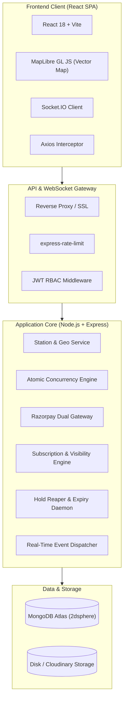
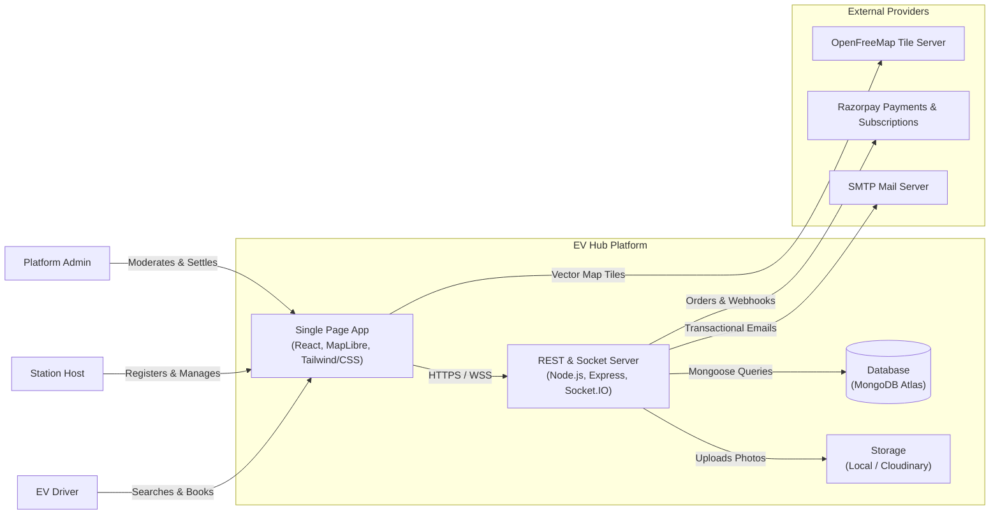
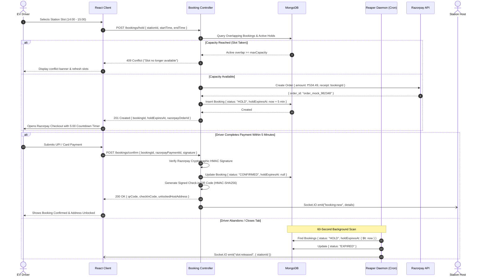
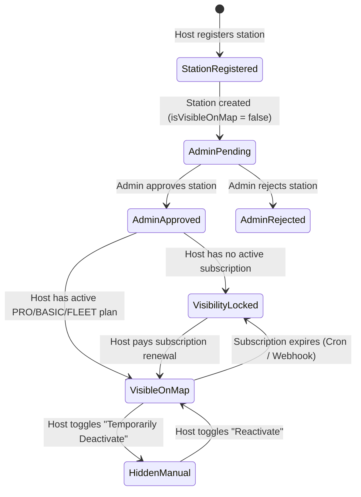

# EV Hub – System Architecture & Technical Design

This document details the software architecture, design patterns, concurrency controls, sequence diagrams, and real-time pipelines of **EV HUB**.

---

## 1. System Overview & Technology Stack

EV Hub is designed as a distributed, modular full-stack MERN platform built for high concurrency, real-time telemetry, and location-based discovery.



---

## 2. High-Level C4 Container Diagram



---

## 3. Concurrency Control & 5-Minute Atomic Hold Lifecycle

A primary technical requirement of EV Hub is **strict concurrency control**: two drivers must never be able to double-book the same physical charger or connector during overlapping time windows.

### Concurrency Strategy:
1. **Capacity Overlap Check**:
   A station has `chargerSpecs.maxSimultaneousVehicles` (typically 1 for residential chargers, up to 4 for multi-plug setups).
   The query checks for active bookings overlapping with `[startTime, endTime]`:
   ```javascript
   const overlappingCount = await Booking.countDocuments({
     station: stationId,
     status: { $in: ['CONFIRMED', 'CHARGING_IN_PROGRESS', 'HOLD'] },
     $or: [
       { startTime: { $lt: requestedEndTime, $gte: requestedStartTime } },
       { endTime: { $gt: requestedStartTime, $lte: requestedEndTime } },
       { startTime: { $lte: requestedStartTime }, endTime: { $gte: requestedEndTime } }
     ],
     $or: [
       { status: { $ne: 'HOLD' } },
       { status: 'HOLD', holdExpiresAt: { $gt: new Date() } }
     ]
   });
   ```
2. **Atomic Hold Allocation**:
   If `overlappingCount < maxSimultaneousVehicles`, the slot is atomically reserved with `status: 'HOLD'` and `holdExpiresAt = new Date(Date.now() + 5 * 60 * 1000)`.
3. **Razorpay Order Generation**:
   A corresponding Razorpay order is initialized with the hold ID embedded in `receipt`.
4. **Reaper Daemon**:
   A background cron engine runs every 60 seconds. Any hold where `holdExpiresAt <= now` is transitioned to `'EXPIRED'`, freeing capacity immediately.

### Sequence Diagram: Slot Reservation & Concurrency Hold



---

## 4. Host Subscription & Station Visibility Synchronization

Charging stations registered by hosts are **strictly hidden from public map discovery** unless the host fulfills two conditions:
1. **Admin Approval**: `OwnerProfile.verificationStatus == 'APPROVED'`
2. **Active Subscription**: `OwnerProfile.activeSubscription` has `status == 'ACTIVE'` and `currentPeriodEnd > now`.

### Visibility State Machine



### Automatic Subscription Expiry Engine:
- **Webhook Channel**: Razorpay emits `subscription.cancelled` or `subscription.charged`. The webhook listener triggers `subscriptionService.syncOwnerStationVisibility(ownerId)`.
- **Cron Reconciler**: Runs daily at midnight to scan for subscriptions where `currentPeriodEnd < now`. Automatically updates `Subscription.status = 'EXPIRED'` and sets `ChargingStation.isVisibleOnMap = false`.

---

## 5. Dual Razorpay Payment Architecture

EV Hub uses a dual payment workflow:

| Workflow | Type | Mechanism | Verification |
| :--- | :--- | :--- | :--- |
| **Driver Bookings** | One-time Standard Checkout | Razorpay Order API -> Checkout JS Modal | Client HMAC-SHA256 signature verification + Webhook backup |
| **Host Subscriptions** | Recurring Recurring Billing | Razorpay Subscriptions API | Webhook events (`subscription.charged`, `subscription.authenticated`) |

```mermaid
flowchart TD
    subgraph Drivers["Driver Payment Flow"]
        D1["Hold Slot"] --> D2["Create Razorpay Order"]
        D2 --> D3["Razorpay Checkout Modal"]
        D3 --> D4["HMAC SHA256 Signature Verification"]
        D4 --> D5["Status: CONFIRMED + QR Code Generated"]
    end

    subgraph Hosts["Host Subscription Flow"]
        H1["Select Plan (Basic/Pro/Fleet)"] --> H2["Create Razorpay Subscription"]
        H2 --> H3["Host Authorizes Mandate / UPI AutoPay"]
        H3 --> H4["Razorpay Webhook: subscription.activated"]
        H4 --> H5["Unlock Host Stations (isVisibleOnMap = true)"]
    end
```



---

## 6. Real-Time Socket.IO Pipeline

Socket.IO provides zero-latency updates across all active connected portals without requiring manual browser refreshing.

### Room Architecture:
- `station:<stationId>`: Joined by drivers browsing a specific station or explore map view. Emits live slot occupation changes and availability indicators.
- `owner:<ownerId>`: Joined by hosts. Receives immediate alerts when a driver books their charger, cancels, or arrives for check-in.
- `user:<userId>`: Joined by drivers. Receives booking status transitions, check-in authorizations, and refund confirmations.
- `admin:global`: Joined by administrators. Streams real-time GMV counters, new user registrations, and dispute alerts.

### Event Catalog:

| Event Name | Direction | Payload | Description |
| :--- | :--- | :--- | :--- |
| `slot:held` | Server -> `station:*` | `{ stationId, slotTime }` | Temporarily flags slot as pending |
| `slot:confirmed` | Server -> `station:*` | `{ stationId, slotTime }` | Turns slot marker red/booked |
| `slot:released` | Server -> `station:*` | `{ stationId, slotTime }` | Re-enables slot after hold expiry |
| `booking:created` | Server -> `owner:*` | `{ bookingId, amount, driverName }` | Rings host sound & notification |
| `charging:started` | Server -> `user:*` | `{ bookingId, startedAt }` | Driver UI shifts to active meter |
| `notification:new` | Server -> `user:*` | `{ title, message, type }` | Toast popup and badge increment |

---

## 7. Privacy & Security Architecture

1. **Masked Residential Host Addresses**:
   - In public discovery (`GET /stations`, Explore Map, Station Detail), the host's exact house number, street address, and phone number are omitted or masked (only suburb and city are returned).
   - Only when a driver successfully pays and confirms a reservation does `GET /bookings/:id` decrypt and reveal the full residential address, entrance landmark, and host phone number.
2. **Cryptographic Check-in Verification**:
   - The QR code contains an HMAC-SHA256 payload generated from the booking ID, user ID, and server secret.
   - When scanned by the host, the server validates the hash to ensure the QR code was not forged or screenshotted from a stale session.
3. **Defense-in-Depth Middleware**:
   - `helmet` for secure HTTP headers.
   - `express-rate-limit` protecting authentication routes against brute-force attacks.
   - Password hashing via `bcrypt` with work factor 12.
   - Refresh token rotation preventing replay attacks.

