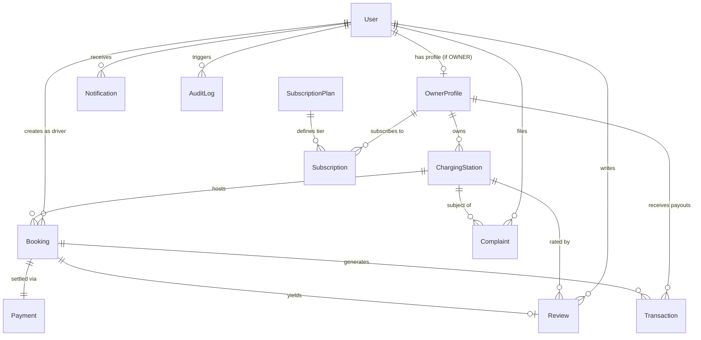

# EV Hub – Database Schema & Data Models

This document details the MongoDB schema, data types, constraints, index definitions, and entity relationships for **EV HUB**.

---

## 1. Entity Relationship Diagram (ERD)

---

## 2. Models Specification

### 2.1 User (`User.js`)
Represents drivers, hosts, and platform administrators.

| Field | Type | Validation / Constraints | Description |
| :--- | :--- | :--- | :--- |
| `name` | `String` | Required, trimmed, max 80 chars | User's full display name |
| `email` | `String` | Required, unique, lowercase, trimmed | Authentication identifier |
| `password` | `String` | Required (bcrypt hash, min 60 chars) | Hashed password (`select: false` by default) |
| `phone` | `String` | Optional, regex validated | Contact telephone number |
| `role` | `String` | Enum: `['ADMIN', 'OWNER', 'USER']`, default: `'USER'` | Access control role |
| `status` | `String` | Enum: `['ACTIVE', 'SUSPENDED', 'PENDING']`, default: `'ACTIVE'` | Account operational status |
| `avatar` | `String` | URL or `/uploads/avatars/...` | Profile avatar image |
| `vehicle` | `Object` | Nested subdocument (for `USER`) | Vehicle specifications |
| `vehicle.make` | `String` | e.g., "Tata", "MG", "Hyundai", "Tesla" | Vehicle brand |
| `vehicle.model`| `String` | e.g., "Nexon EV Max", "ZS EV", "Ioniq 5" | Model name |
| `vehicle.regNo`| `String` | Vehicle registration license plate | RTO plate number |
| `vehicle.connector` | `String`| Enum: `['CCS_TYPE_2', 'TYPE_2_AC', 'CHADEMO', 'GB_T', 'WALL_OUTLET_15A']` | Native port |
| `favorites` | `[ObjectId]`| Ref: `'ChargingStation'` | Bookmarked station IDs |
| `passwordResetToken` | `String` | Hashed token for recovery | Single-use recovery token |
| `passwordResetExpires` | `Date` | Timestamp | Expiry for recovery token (10 min) |
| `refreshTokenHash` | `String` | Hashed refresh token | Rotated refresh session token |
| `createdAt` / `updatedAt` | `Date` | Managed by Mongoose timestamps | Audit timestamps |

**Indexes**:
- `{ email: 1 }` (Unique)
- `{ role: 1 }`

---

### 2.2 OwnerProfile (`OwnerProfile.js`)
Stores host verification, residential proof, and payment settlement accounts.

| Field | Type | Validation / Constraints | Description |
| :--- | :--- | :--- | :--- |
| `user` | `ObjectId` | Required, unique, Ref: `'User'` | Host account reference |
| `residentialAddress` | `Object` | Required | Host legal residential address |
| `residentialAddress.street` | `String` | Required | Street address / villa / apartment |
| `residentialAddress.area` | `String` | Required | Suburb / neighborhood |
| `residentialAddress.city` | `String` | Required | City name |
| `residentialAddress.state` | `String` | Required | State / province |
| `residentialAddress.pincode`| `String` | Required, 6 digits | Postal code |
| `idProof` | `Object` | KYC verification document | Identity proof metadata |
| `idProof.type` | `String` | Enum: `['AADHAAR', 'PAN', 'DRIVING_LICENSE', 'PASSPORT']` | ID type |
| `idProof.number` | `String` | Masked document number | Identification number |
| `idProof.documentUrl` | `String` | Document image link | Uploaded photo of ID |
| `verificationStatus` | `String` | Enum: `['PENDING', 'APPROVED', 'REJECTED']`, default: `'PENDING'` | Admin moderation status |
| `rejectionReason` | `String` | Optional | Explanation if rejected by admin |
| `bankAccount` | `Object` | Required for payout disbursements | Host settlement details |
| `bankAccount.accountNumber` | `String` | Masked in responses | Settlement bank account |
| `bankAccount.ifscCode` | `String` | Valid IFSC format | Indian Financial System Code |
| `bankAccount.accountHolder`| `String` | Beneficiary name | Account holder name |
| `activeSubscription` | `ObjectId` | Ref: `'Subscription'` | Pointer to current active plan |
| `totalEarnings` | `Number` | Default: `0` | Cumulative earnings in INR |
| `pendingPayout` | `Number` | Default: `0` | Balance awaiting disbursement |

---

### 2.3 ChargingStation (`ChargingStation.js`)
Core geospatial entity representing a physical residential EV charger.

| Field | Type | Validation / Constraints | Description |
| :--- | :--- | :--- | :--- |
| `owner` | `ObjectId` | Required, Ref: `'User'` | Host who owns the charger |
| `name` | `String` | Required, trimmed, max 100 chars | Public station listing name |
| `description` | `String` | Max 1000 chars | Host instructions, landmarks |
| `location` | `Object` | GeoJSON `Point` | Coordinates for geospatial queries |
| `location.type` | `String` | Default: `'Point'`, Enum: `['Point']` | GeoJSON type |
| `location.coordinates` | `[Number]` | `[longitude, latitude]` | Geo coordinates (order: lon, lat!) |
| `address` | `Object` | Required | Station physical address |
| `address.street` | `String` | Masked until booking confirmed | Precise street and gate number |
| `address.area` | `String` | Publicly visible | Suburb / neighborhood |
| `address.city` | `String` | Publicly visible | City |
| `address.state` | `String` | Publicly visible | State |
| `address.pincode`| `String` | Publicly visible | Postal code |
| `chargerSpecs` | `Object` | Required | Electrical specifications |
| `chargerSpecs.chargerBrand` | `String` | e.g., "ABB", "Delta", "Tata Power" | Equipment manufacturer |
| `chargerSpecs.chargerModel` | `String` | Hardware model identifier | Model string |
| `chargerSpecs.connectorType` | `String` | Enum: `['CCS_TYPE_2', 'TYPE_2_AC', 'CHADEMO', 'GB_T', 'WALL_OUTLET_15A']` | Plug compatibility |
| `chargerSpecs.chargingType` | `String` | Enum: `['AC', 'DC']`, default: `'AC'` | Current type |
| `chargerSpecs.capacityKw` | `Number` | Min: 2.3, Max: 350 | Maximum output capacity in kW |
| `chargerSpecs.maxSimultaneousVehicles` | `Number` | Min: 1, Default: 1 | Number of concurrent plugs |
| `pricing` | `Object` | Required | Pricing structure |
| `pricing.ratePerKwh` | `Number` | Min: 0 | Price per kilowatt-hour (INR) |
| `pricing.ratePerHour` | `Number` | Min: 0 | Hourly parking/charging fee (INR) |
| `operatingHours` | `Object` | Default: `06:00` to `23:00` | Daily operational window |
| `operatingDays` | `[String]` | Default: all 7 days | Active days of the week |
| `slotDurationMinutes` | `Number` | Default: 60 | Default bookable block |
| `bufferTimeMinutes` | `Number` | Default: 15 | Idle buffer between bookings |
| `photos` | `[String]` | Array of image URLs | Station photos |
| `approvalStatus` | `String` | Enum: `['PENDING', 'APPROVED', 'REJECTED']`, default: `'PENDING'` | Admin vetting status |
| `isActive` | `Boolean` | Default: `true` | Host manual toggle |
| `isVisibleOnMap` | `Boolean` | Default: `false` | Managed by subscription engine |
| `availabilityStatus` | `String` | Enum: `['AVAILABLE', 'BUSY', 'OFFLINE']`, default: `'AVAILABLE'` | Real-time status |
| `rating` | `Object` | Embedded rating summary | Average score and total count |
| `rating.average` | `Number` | Default: 0.0, range 0 to 5 | Cached average rating |
| `rating.count` | `Number` | Default: 0 | Number of verified reviews |

**Indexes**:
- `{ location: "2dsphere" }` (Critical for geospatial `$near` and `$geoWithin` searches)
- `{ owner: 1 }`
- `{ approvalStatus: 1, isVisibleOnMap: 1, isActive: 1 }` (High-performance compound filter for public explore map)

---

### 2.4 Booking (`Booking.js`)
Manages slot reservation, concurrency hold, and charging lifecycle.

| Field | Type | Validation / Constraints | Description |
| :--- | :--- | :--- | :--- |
| `user` | `ObjectId` | Required, Ref: `'User'` | Driver who booked the slot |
| `station` | `ObjectId` | Required, Ref: `'ChargingStation'` | Target station |
| `owner` | `ObjectId` | Required, Ref: `'User'` | Station host |
| `startTime` | `Date` | Required | Reservation start timestamp |
| `endTime` | `Date` | Required | Reservation end timestamp |
| `status` | `String` | Enum: `['HOLD', 'CONFIRMED', 'CHARGING_IN_PROGRESS', 'COMPLETED', 'CANCELLED', 'EXPIRED']` | Booking lifecycle status |
| `holdExpiresAt` | `Date` | Sparse Index | 5-minute concurrency hold window |
| `amount` | `Object` | Required | Monetary breakdown |
| `amount.subtotal` | `Number` | Station base charging cost | Subtotal before fees |
| `amount.discount` | `Number` | Coupon deduction | Discount applied |
| `amount.platformFee` | `Number` | EV Hub service commission | Platform commission |
| `amount.tax` | `Number` | GST / VAT component | Tax amount |
| `amount.totalAmount` | `Number` | Final billable amount | Net payable by driver |
| `amount.hostEarnings` | `Number` | Payout portion | Host settlement share |
| `qrCode` | `String` | Base64 PNG data URI | Check-in verification QR |
| `checkInCode` | `String` | 8-character human fallback | e.g., "EVH-84920" |
| `securityHash` | `String` | HMAC SHA256 of bookingId + secret | Cryptographic check-in signature |
| `checkedInAt` | `Date` | Optional | Session start timestamp |
| `completedAt` | `Date` | Optional | Session completion timestamp |
| `cancellationReason` | `String` | Optional | Host or driver cancel note |
| `refundAmount` | `Number` | Optional | Amount refunded if cancelled |

**Indexes**:
- `{ station: 1, startTime: 1, endTime: 1, status: 1 }` (Critical for atomic double-booking prevention)
- `{ holdExpiresAt: 1 }` (Used by background cron engine to release abandoned holds)
- `{ user: 1, createdAt: -1 }`
- `{ owner: 1, createdAt: -1 }`

---

### 2.5 Payment (`Payment.js`)

| Field | Type | Description |
| :--- | :--- | :--- |
| `booking` | `ObjectId` | Ref: `'Booking'` (optional for subscriptions) |
| `subscription` | `ObjectId` | Ref: `'Subscription'` (optional for booking payments) |
| `user` | `ObjectId` | Ref: `'User'` |
| `razorpayOrderId` | `String` | Gateway order identifier (`order_...`) |
| `razorpayPaymentId`| `String` | Gateway payment identifier (`pay_...`) |
| `razorpaySignature`| `String` | Gateway cryptographic signature |
| `amount` | `Number` | Total amount in INR |
| `currency` | `String` | Default: `'INR'` |
| `status` | `String` | Enum: `['PENDING', 'CAPTURED', 'FAILED', 'REFUNDED']` |
| `paymentMethod` | `String` | e.g., `'UPI'`, `'CARD'`, `'NETBANKING'` |

---

### 2.6 Subscription (`Subscription.js`) & SubscriptionPlan (`SubscriptionPlan.js`)

#### SubscriptionPlan
- `code`: `String` (Unique, e.g., `'BASIC'`, `'PRO'`, `'FLEET'`)
- `name`: `String` ("Basic Host", "Pro Host", "Fleet Enterprise")
- `priceMonthly`: `Number` (₹499, ₹1,299, ₹2,999)
- `maxStations`: `Number` (1, 3, or unlimited: 999)
- `commissionPercent`: `Number` (12%, 8%, 5%)
- `features`: `[String]`
- `isActive`: `Boolean`

#### Subscription
- `owner`: `ObjectId` (Ref: `'User'`)
- `plan`: `ObjectId` (Ref: `'SubscriptionPlan'`)
- `razorpaySubscriptionId`: `String`
- `status`: `['PENDING', 'ACTIVE', 'EXPIRED', 'CANCELLED']`
- `currentPeriodStart`: `Date`
- `currentPeriodEnd`: `Date`
- `autoRenew`: `Boolean`

---

### 2.7 Review (`Review.js`)
- `booking`: `ObjectId` (Ref: `'Booking'`, Unique: 1 review per booking)
- `station`: `ObjectId` (Ref: `'ChargingStation'`)
- `user`: `ObjectId` (Ref: `'User'`)
- `rating`: `Number` (1 to 5)
- `comment`: `String` (max 500 chars)
- `ownerReply`: `Object` (`{ comment: String, repliedAt: Date }`)

---

### 2.8 Notification (`Notification.js`)
- `recipient`: `ObjectId` (Ref: `'User'`)
- `title`: `String`
- `message`: `String`
- `type`: `['BOOKING', 'PAYMENT', 'VERIFICATION', 'SYSTEM']`
- `isRead`: `Boolean` (Default: `false`)
- `readAt`: `Date`
- `metadata`: `Object` (`{ bookingId, stationId, ... }`)

---

### 2.9 Transaction (`Transaction.js`)
Financial ledger recording all platform revenue inflows and host settlement outflows.
- `type`: `['BOOKING_PAYMENT', 'HOST_PAYOUT', 'SUBSCRIPTION_FEE', 'REFUND']`
- `amount`: `Number`
- `platformFee`: `Number`
- `hostShare`: `Number`
- `status`: `['PENDING', 'COMPLETED', 'FAILED']`
- `referenceId`: `String` (Booking ID or Razorpay Payout ID)

---

### 2.10 Complaint (`Complaint.js`)
Support ticket system for dispute management between drivers and hosts.
- `user`: `ObjectId` (Ref: `'User'`)
- `booking`: `ObjectId` (Ref: `'Booking'`)
- `station`: `ObjectId` (Ref: `'ChargingStation'`)
- `subject`: `String`
- `description`: `String`
- `priority`: `['LOW', 'MEDIUM', 'HIGH', 'CRITICAL']`
- `status`: `['OPEN', 'INVESTIGATING', 'RESOLVED', 'CLOSED']`
- `resolutionNotes`: `String`

---

### 2.11 AuditLog (`AuditLog.js`)
Immutable audit trail recording administrative actions for regulatory compliance.
- `actor`: `ObjectId` (Ref: `'User'`)
- `action`: `String` (e.g., `'APPROVE_HOST'`, `'REJECT_STATION'`, `'SETTLE_PAYOUT'`, `'UPDATE_SETTINGS'`)
- `targetModel`: `String` (e.g., `'OwnerProfile'`, `'ChargingStation'`)
- `targetId`: `ObjectId`
- `ipAddress`: `String`
- `userAgent`: `String`
- `details`: `Object`
- `timestamp`: `Date` (Default: `Date.now`)

